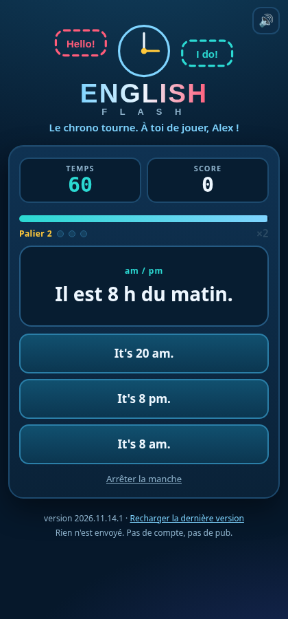
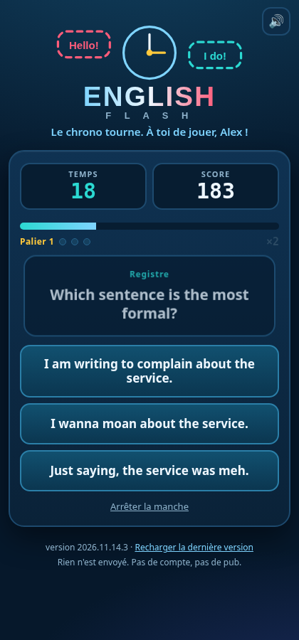
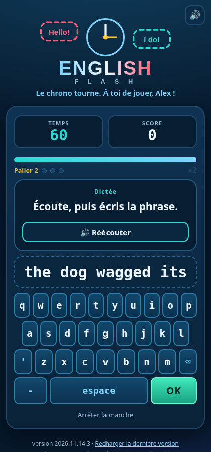

<div align="center">

# English Flash

**60 secondes. Du collège 6e à l'anglais d'une école britannique.**

Arcade d'anglais dans le navigateur, cinq niveaux. Rien n'est envoyé.

</div>

---

Borne d'arcade, petite sœur de [calcul-flash](https://github.com/fschmutz/calcul-flash) et de
[physique-flash](https://github.com/fschmutz/physique-flash). Prénom, puis niveau / entraînement / difficulté / durée.
Manche chronométrée, séries à multiplicateur, récap de fin de manche, **Rejouer les erreurs** qui repasse
exactement les questions ratées. Consignes en français, contenu en anglais, tout hors ligne.

Le programme vient du cahier d'anglais de 6ème (Collège Provence), Unit 4 *My daily routine* : la fiche
« Je sais dire et écrire… » et les vocabox collées dans le cahier. Tout est recopié dans
[SYLLABUS.md](SYLLABUS.md), et un test refuse une banque de questions qui s'en écarte. Un cran au-dessus du
cahier : c'est de l'entraînement, pas une recopie des exercices.

Au-dessus, quatre niveaux pour une élève qui parle déjà presque comme une native et veut l'anglais d'une
école britannique exigeante : jusqu'au GCSE puis au-delà.

## Screenshots

| Niveau et entraînement | Une question à toucher | Orthographe au clavier | Fin de manche |
|---|---|---|---|
|  |  |  |  |

| Niveau 4, GCSE | Dictée |
|---|---|
|  |  |

Les captures sont prises avec un prénom fictif.

## Niveaux

| Niveau | Pour qui | Ce qu'on travaille |
| --- | --- | --- |
| 1 · Collège 6e | l'évaluation de l'Unit 4, niveau par défaut | les sept entraînements ci-dessous, rien en dehors de la fiche de révision |
| 2 · UK Year 7-8 | 11-13 ans au Royaume-Uni | tous les temps (present / past perfect, continuous), verbes irréguliers, comparatifs et superlatifs, question tags |
| 3 · UK Year 9 | 13-14 ans | conditionnels 0 à 3, passif, discours indirect, modaux (*might / should / must have*), phrasal verbs, idioms |
| 4 · GCSE | 14-16 ans | analyse de la langue (metaphor, simile, personification, alliteration, tone), registre formel / informel, classes de mots, types de phrases et leur effet |
| 5 · Native stretch | au-delà | confusables (*affect / effect, fewer / less, who / whom, its / it's, practise / practice*), vocabulaire et collocations, anglais britannique ou américain, ponctuation (; : ' ,) |

Trois modes à chaque niveau : **Orthographe** (mots pièges du niveau et orthographe britannique *colour,
organise, centre*, au clavier de la borne), **Repère l'erreur** (toucher le mot faux, ou sa correction) et
**Dictée** (la phrase est lue par une voix anglaise de l'appareil, en-GB de préférence, avec un bouton
**Réécouter** ; ponctuation et majuscules ne comptent pas). La dictée n'utilise que les voix installées sur
l'appareil : rien ne part sur le réseau. Sans voix anglaise, un message en français explique comment en ajouter
une, et la manche ne se lance pas.

Le niveau suivant s'ouvre à 85 % de réussite sur le niveau d'avant, sur une manche d'au moins 10 questions.
Le meilleur pourcentage par niveau et par joueur reste dans `localStorage`. **Mode parent : ouvrir tous les
niveaux** lève le verrou. Au démarrage, c'est toujours le niveau 1.

## Entraînements du niveau 1

| Mode | Ce qu'on révise | Comment on répond |
| --- | --- | --- |
| `routine` | Vocabox *Morning routine* et *Daily routine*, anglais ↔ français, *eat / have*, First / Then / After / Finally. | Boutons à toucher |
| `free` | Vocabox *Free time activities* : DO, GO ou PLAY ? Traductions, et compréhension des quatre textes *Around the world* (leurs activités, pas leur pays). | Boutons à toucher |
| `present` | Présent simple aux trois formes : le -s de la 3e personne, *don't / doesn't*, *Do / Does*, la bonne phrase négative ou interrogative (*Tom doesn't watch*, jamais *doesn't watches*), habitude → présent simple et pas -ing, réponses courtes, *am / is / are*, *have / has*, prononciation /s/ /z/ /iz/. | Boutons à toucher |
| `poss` | my, your, his, her, its, our, their selon le sujet ; au palier 3, déterminant (*her bag*) ou pronom (*it's hers*). | Boutons à toucher |
| `time` | L'heure, méthode 1 (*a quarter to six*, *twenty-five past ten*) et méthode 2 (*seven fifteen*, *eleven O five*), dans les deux sens, et am / pm. | Boutons à toucher |
| `spell` | Écrire sans faute : les mots des vocabox, le verbe à la 3e personne (*brushes*, *goes*, *has*), le déterminant possessif. | Clavier QWERTY de la borne |
| `mix` | Tout, sans prévenir, avec plus de présent simple et d'heure. | Les deux |

Plus **Repère l'erreur** et **Dictée**, avec des phrases de l'Unit 4.

Trois difficultés (Tranquille / 6ème / 5ème au niveau 1, Échauffement / Standard / Défi au-dessus), cinq paliers qui montent avec les séries, manches de 45 s, 60 s ou
2 min. Au palier 1, trois réponses au choix ; ensuite quatre.

Le clavier de l'orthographe est celui de la borne, pas celui du téléphone : pas de correcteur automatique ni
de suggestion, l'orthographe reste celle de l'élève. Majuscules et espaces en trop ne comptent pas.

## Vie privée

Pas de compte, pas de réseau, pas d'analytics, pas de police distante. Seuls le prénom et les records locaux
vont dans `localStorage`. La CSP est `default-src 'self'`. Les polices sont celles du système.

## En local

```bash
python3 -m http.server 8080
# http://localhost:8080
```

```bash
node --test "test/*.test.mjs"
```

Les tests vérifient les générateurs sans navigateur : chaque QCM a exactement une bonne option et pas de
doublon, chaque réponse est recalculée par des tables écrites à part (`test/expected.mjs` : 3e personne,
possessif par sujet, les deux méthodes de l'heure), la banque de vocabulaire est identique aux listes de
[SYLLABUS.md](SYLLABUS.md), aucun mot inadapté ne peut sortir, et aucun énoncé ne se répète dans la fenêtre de
mémoire du distributeur.

Pour les niveaux 2 à 5 (`test/levels.test.mjs`) : chaque bonne réponse est comparée à un corrigé tapé à part
(`test/key.mjs`), les verbes irréguliers et l'anglais britannique à des tables retapées, les comparatifs à leur
règle ; chaque question générée a au moins trois options et une seule juste ; « repère l'erreur » a un seul mot
faux ; chaque dictée se tape au clavier de la borne ; chaque niveau a plus de 40 questions différentes ; le
déblocage à 85 % est testé. `test/sources.test.mjs` garde le niveau 1 sur la fiche : chaque question porte sa
page du cahier et un des six thèmes de l'Unit 4.

## GitHub Pages

Site statique servi depuis la racine de `main`, comme `calcul-flash` : pas de build, pas de workflow, juste
`.nojekyll`. La page ne sera en ligne qu'après fusion, et une fois Pages activé sur le dépôt
(*Settings → Pages → Deploy from a branch → `main` / `/`*).

Si la page semble vieille après une mise à jour, touchez **Recharger la dernière version** en bas : le service
worker garde sinon l'ancienne version.

## Dépôt

Créé depuis le modèle `ScaleMeNow/GITHUB-TEMPLATE` : les fichiers communautaires, le wiki dans `wiki/`, la CI
(`ci.yml`, qui lance aussi `node --test`) et le contrôle d'attribution viennent de là. Voir
[CONTRIBUTING.md](CONTRIBUTING.md) et [AGENTS.md](AGENTS.md).

## Licence

MIT. Copyright (c) 2026 [Falco Schmutz](https://github.com/fschmutz).
