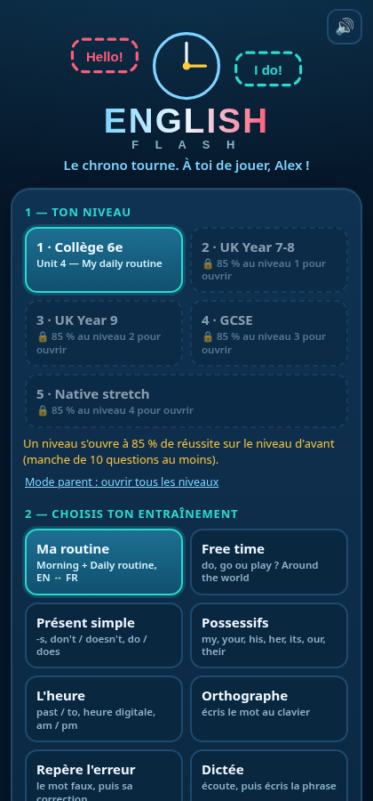
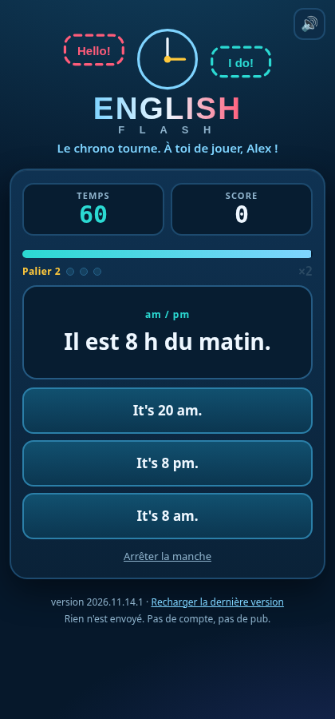
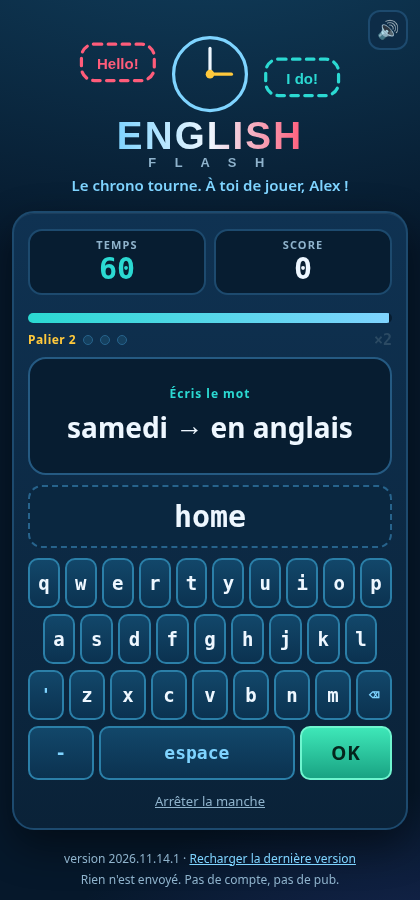
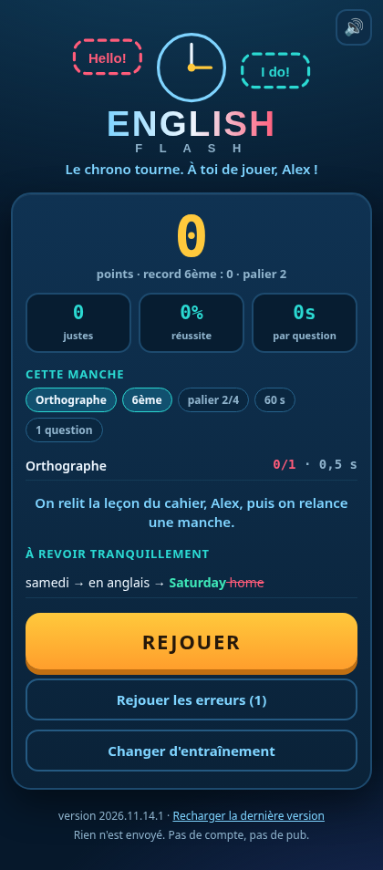
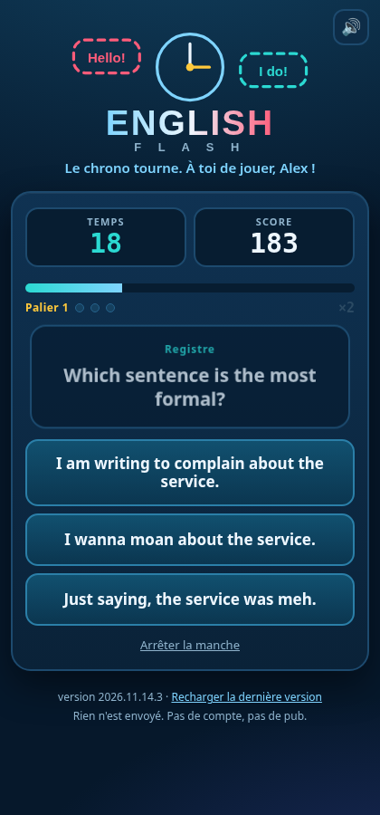
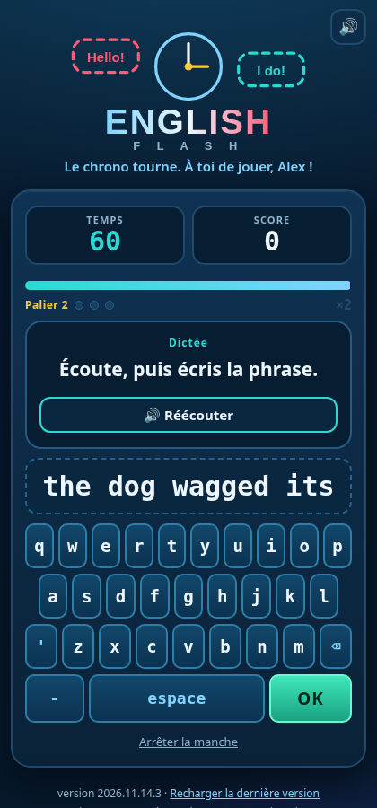

# English Flash

Arcade d'anglais 6ème (Unit 4 *My daily routine*), statique, hors ligne. Ce wiki est la surface de
documentation du dépôt ; il vient du modèle
[`ScaleMeNow/GITHUB-TEMPLATE`](https://github.com/ScaleMeNow/GITHUB-TEMPLATE).

> **This wiki is generated.** Every page here is a file in the `wiki/` directory
> of the repository, published by `.github/workflows/wiki.yml` on each push to
> the default branch. **Edits made in the GitHub wiki UI are overwritten** by the
> next sync.
> To change a page, edit the matching file in `wiki/` and open a pull request.

## Start here

- **[Getting Started](Getting-Started)** — create a repository from the template,
  replace the placeholders, and get CI green.
- **[Bundles](Bundles)** — what runs on day one, what ships switched off, and
  how to turn each one on or remove it.
- **[Architecture Decisions](Architecture-Decisions)** — why the repository is
  shaped this way, and what the alternatives were.

## Screenshots

Captures de la borne, prises avec un prénom fictif.

## How this wiki works

| | |
|---|---|
| Source of truth | `wiki/` in the repository |
| Published by | `.github/workflows/wiki.yml` → `scripts/wiki-sync.sh` |
| Trigger | push to the default branch touching `wiki/**`, or a manual run |
| Page name | the filename, with `-` rendered as a space |
| Links between pages | the page name, not the filename: `[Getting Started](Getting-Started)` |

Adding a page is one file: create `wiki/My-Page.md`, open a pull request, and the
merge publishes it. Deleting the file deletes the page — the sync mirrors, it does
not merge.

A new repository needs the wiki bootstrapped once by hand before any of this
works — see [Getting Started](Getting-Started), step 7.

## Why a wiki and not Pages

ScaleMeNow operator repositories are private, and a private repository cannot
serve Pages without making the docs public. The wiki inherits the repository's
access control, costs nothing to run, and stays reviewable because the source
lives in the repository.

The trade-off, stated plainly: the wiki has no custom styling and no build step.
For a public, human-facing product surface, Pages from a `docs/` directory is the
better answer — but pick **one**. Two documentation sources drift, and the
unmaintained one is the one people find.

## Conventions

- One page, one subject. A page that needs a table of contents usually wants to
  be two pages.
- Name files as titles: `Runbook-Database-Failover.md`, not `db_failover.md`.
- Write for the person on call at 03:00 who has not read the rest of this wiki.
- No secrets, no credentials, no customer identifiers. The wiki is part of the
  repository and is scanned like the rest of it.

## Repository documents

Some documents stay in the repository rather than the wiki, because GitHub renders
them in the interface where they matter:

- [`README.md`](https://github.com/ScaleMeNow/GITHUB-TEMPLATE/blob/main/README.md) — what this is and how to use the template
- [`CONTRIBUTING.md`](https://github.com/ScaleMeNow/GITHUB-TEMPLATE/blob/main/CONTRIBUTING.md) — branch, commit, and pull request conventions
- [`AGENTS.md`](https://github.com/ScaleMeNow/GITHUB-TEMPLATE/blob/main/AGENTS.md) — the same conventions, as a contract for AI assistants
- [`SECURITY.md`](https://github.com/ScaleMeNow/GITHUB-TEMPLATE/blob/main/SECURITY.md) — how to report a vulnerability privately
- [`SUPPORT.md`](https://github.com/ScaleMeNow/GITHUB-TEMPLATE/blob/main/SUPPORT.md) — where to ask a question that is not a vulnerability
- [`CHANGELOG.md`](https://github.com/ScaleMeNow/GITHUB-TEMPLATE/blob/main/CHANGELOG.md) — what changed and when
